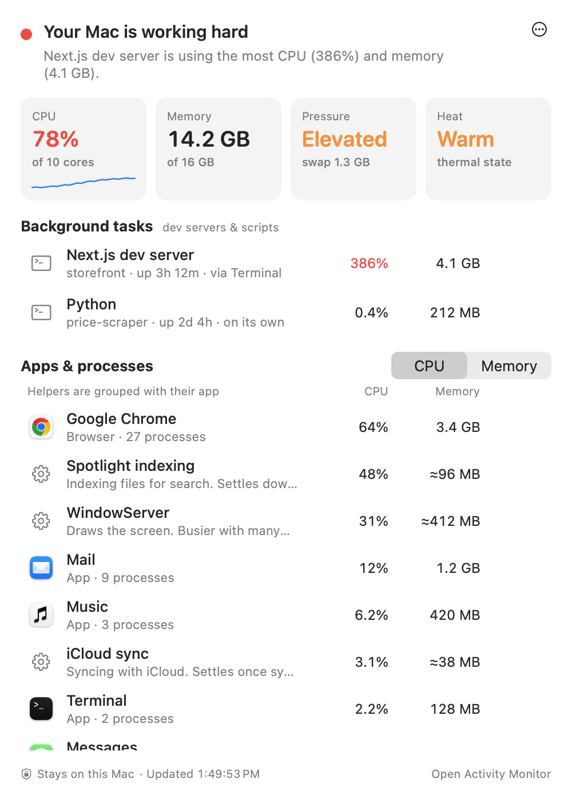

<p align="center"></p>

<h1 align="center">MacSweat</h1>
<p align="center"><b>Why is your Mac sweating?</b><br>A free menu bar app that shows, in one click, what's heating up or slowing down your Mac, so you can close it yourself.</p>

<p align="center"></p>

## Install

```sh
curl -fsSL https://macsweat.parthh.dev/install | sh
```

The script downloads the latest release from GitHub and checks its SHA-256. Then it installs MacSweat to `/Applications` and opens it. [Read the script](site/install) before running it. Run the same command again to update.

```sh
curl -fsSL https://macsweat.parthh.dev/uninstall | sh
```

**Requirements:** macOS 13 Ventura or later, Apple silicon or Intel. On macOS 26 and later, if the drop icon doesn't show up, allow MacSweat in System Settings ▸ Menu Bar.

**Why a Terminal command?** MacSweat is free and isn't notarized by Apple (notarization needs a $99/year developer account). So macOS would block a zip downloaded in a browser. The install script avoids that, and it's short enough to read.

## What it shows

- **A one-line verdict:** for example, "Your Mac is working hard. Next.js dev server is using the most CPU (386%) and memory (4.1 GB)." A dot next to it turns green, orange or red.
- **CPU, memory, memory pressure, swap and heat.** Memory matches Activity Monitor's "Memory Used". Heat is macOS's thermal state; when it says *Hot*, macOS is slowing down to cool off.
- **Background tasks:** dev servers and scripts (Node.js, Next.js, Vite, Python, PostgreSQL…), grouped by project. Each shows how long it has been running and which app started it, or "on its own" if it was left behind.
- **Apps & processes,** sorted by CPU or memory:
  - Helpers are grouped with their app, so Chrome's 25 helpers count as Chrome and WebKit pages count under Safari.
  - macOS services get plain names like "Spotlight indexing" or "iCloud sync".
  - CPU uses Activity Monitor's scale: 100% = one full core.
- **You decide what closes.** Hover a row for **Quit** (apps quit normally) or **Stop** (dev tasks get the same signal as Control-C). Both ask first. Nothing is closed automatically.

## Privacy

Everything is read on your Mac. There's no account, analytics or tracking. The only network request is the optional **Check for Updates…** menu item, which asks GitHub for the latest version number.

MacSweat refreshes every 3 s while its panel is open. While the panel is closed, it reads overall CPU and memory every 5 s and the full process list every 30 s.

## Build from source

```sh
./build.sh            # universal build → build/MacSweat.app
./build.sh --install  # also copies it to /Applications and opens it
```

Useful flags on the built binary (`MacSweat.app/Contents/MacOS/MacSweat`):

| Flag | What it does |
|---|---|
| `--check` | Prints a text reading to compare against `top` or Activity Monitor |
| `--login-item on\|off\|status` | Same as **Open at Login** in the ⋯ menu |
| `--demo --snapshot DIR [--light\|--dark]` | Renders the panel with sample data to PNG (used for the website screenshots) |

### Releasing

1. Bump `VERSION`.
2. Run `scripts/release.sh`. It builds, zips to `dist/`, and stamps `site/install` with the version and checksum.
3. Commit, then run `scripts/release.sh --publish`. It uploads that exact zip as a GitHub release and deploys `site/` to Vercel.

### Limits

- Memory for other users' processes (WindowServer and other system services) is their resident size, marked ≈. macOS only gives Activity Monitor the exact figure.
- `kernel_task` isn't listed, because macOS doesn't expose it to regular apps. The Heat tile is the better signal for thermal slowdowns.

## License

[MIT](LICENSE) © 2026 Parth · [macsweat.parthh.dev](https://macsweat.parthh.dev)
